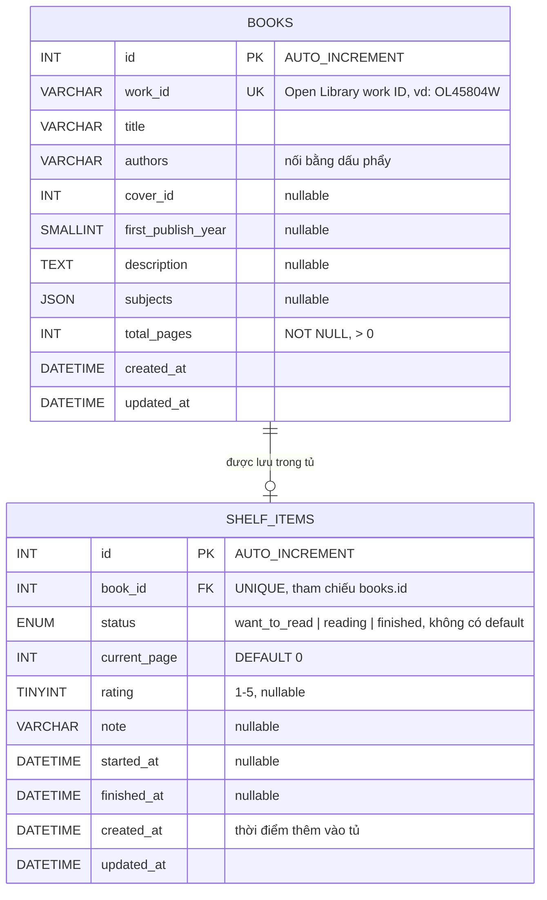

# 📚 Mini Reading Tracker

Ứng dụng web nhỏ giúp tìm sách, lưu vào tủ sách cá nhân và theo dõi tiến độ đọc. Dữ liệu sách được lấy từ [Open Library API](https://openlibrary.org/developers/api) (thông qua backend), dữ liệu tủ sách được lưu trong MySQL.

- **Frontend URL:** https://`<frontend-url>`
- **Backend URL:** https://`<backend-url>`
- **API docs:** https://`<backend-url>`/api-docs

---

## Mục lục

1. Giới thiệu
2. Công nghệ sử dụng
3. Hướng dẫn chạy local
4. Kiến trúc & sơ đồ database
5. Danh sách API
6. Mô tả cách deploy
7. Giả định, hạn chế & hướng cải thiện

---

## 1. Giới thiệu

### Chức năng chính

- **Tìm kiếm sách** theo tên hoặc tác giả, phân trang, hiển thị đủ trạng thái loading / không có kết quả / lỗi. Sách đã có trong tủ hiển thị badge **"Đã thêm"**.
- **Chi tiết sách**: ảnh bìa, tên, tác giả, mô tả, số trang, chủ đề, năm xuất bản; cho phép thêm vào tủ với trạng thái ban đầu (Muốn đọc / Đang đọc / Đã đọc).
- **Tủ sách của tôi**: 3 tab theo trạng thái, thống kê nhanh, thanh tiến độ %, cập nhật số trang, đổi trạng thái, chấm điểm 1–5 sao, ghi chú, xoá khỏi tủ (có xác nhận).
- Không yêu cầu đăng nhập (ứng dụng dành cho một người dùng).

### Ảnh chụp màn hình

| Tìm kiếm sách | Chi tiết sách | Tủ sách của tôi |
| :---: | :---: | :---: |
|  |  |  |


---

## 2. Công nghệ sử dụng

| Thành phần | Công nghệ | Ghi chú |
| --- | --- | --- |
| Frontend | Vue 3 (Composition API) + Vite | Vue Router, Pinia, Axios |
| Backend | Node.js >= 20 + Express + **TypeScript** | Kiến trúc route → controller → service |
| ORM | **TypeORM** | Entity, Repository / QueryBuilder, migration; driver `mysql2` |
| Validation | Zod *(hoặc Joi)* | Validate toàn bộ input ở backend |
| Database | MySQL 8 (local) / TiDB Cloud Starter (deploy, tương thích MySQL) | Xem [mục 6](#6-mô-tả-cách-deploy) |
| Public API | Open Library | Miễn phí, không cần API key |
| Khác | dotenv, cors, helmet, express-rate-limit, morgan, reflect-metadata | Bảo mật & logging cơ bản |
| Deploy | Cloudflare Pages + Render (Free) + TiDB Cloud Starter


---

## 3. Hướng dẫn chạy local

### Yêu cầu

- Node.js >= 20
- MySQL >= 8 (hoặc Docker)
- npm / pnpm / yarn

### Cấu trúc thư mục

```
reading-tracker/
├── backend/
│   ├── src/
│   │   ├── config/          # env, TypeORM DataSource
│   │   ├── entities/        # Book.ts, ShelfItem.ts
│   │   ├── migrations/      # migration do TypeORM sinh ra từ entity
│   │   ├── seeds/           # seed.ts (dữ liệu mẫu)
│   │   ├── routes/
│   │   ├── controllers/
│   │   ├── services/        # business logic + gọi Open Library + truy vấn DB qua TypeORM
│   │   ├── validators/      # schema validate
│   │   ├── middlewares/     # error handler, validate, not found
│   │   └── app.ts
│   ├── .env.example
│   ├── tsconfig.json        # bật experimentalDecorators, emitDecoratorMetadata
│   └── package.json
├── frontend/
│   ├── src/
│   │   ├── views/           # SearchView, BookDetailView, ShelfView
│   │   ├── components/
│   │   ├── stores/          # Pinia
│   │   ├── api/             # axios client
│   │   └── router/
│   ├── .env.example
│   └── package.json
├── docs/screenshots/
└── README.md
```

### Bước 1 — Clone repo

```bash
git clone https://github.com/<username>/reading-tracker.git
cd reading-tracker
```

### Bước 2 — Tạo database rỗng

**Cách A: dùng Docker**

```bash
docker run -d --name rt-mysql \
  -e MYSQL_ROOT_PASSWORD=root \
  -e MYSQL_DATABASE=reading_tracker \
  -p 3306:3306 mysql:8
```

**Cách B: MySQL cài sẵn**

```sql
CREATE DATABASE reading_tracker CHARACTER SET utf8mb4 COLLATE utf8mb4_unicode_ci;
```

Chỉ cần tạo database rỗng. Các bảng sẽ được tạo bằng migration của TypeORM ở bước sau.

### Bước 3 — Chạy backend

```bash
cd backend
cp .env.example .env        # rồi chỉnh lại thông tin DB
npm install
npm run migration:run       # tạo bảng books, shelf_items
npm run seed                # (tuỳ chọn) nạp dữ liệu mẫu
npm run dev                 # mặc định http://localhost:3000
```

`backend/.env.example`:

```env
PORT=3000
NODE_ENV=development

DB_HOST=localhost
DB_PORT=3306
DB_USER=root
DB_PASSWORD=root
DB_NAME=reading_tracker
DB_SSL=false               # đặt true khi dùng DB managed (TiDB Cloud, Aiven...)
# DB_SSL_CA=               # nội dung chứng chỉ CA nếu nhà cung cấp yêu cầu (vd: Aiven)

CORS_ORIGIN=http://localhost:5173
OPEN_LIBRARY_BASE_URL=https://openlibrary.org
```

### Bước 4 — Chạy frontend

```bash
cd frontend
cp .env.example .env
npm install
npm run dev                 # mặc định http://localhost:5173
```

`frontend/.env.example`:

```env
VITE_API_BASE_URL=http://localhost:3000/api
```

### Scripts hữu ích (backend)

| Lệnh | Mô tả |
| --- | --- |
| `npm run dev` | Chạy chế độ development (hot reload) |
| `npm run build` | Biên dịch TypeScript sang `dist/` |
| `npm start` | Chạy bản đã build (production) |
| `npm run migration:generate -- src/migrations/<Tên>` | Sinh migration bằng cách so sánh entity với DB hiện tại |
| `npm run migration:run` | Chạy các migration chưa áp dụng |
| `npm run migration:revert` | Hoàn tác migration gần nhất |
| `npm run seed` | Nạp dữ liệu mẫu |

---

## 4. Kiến trúc & sơ đồ database

### 4.1. Kiến trúc tổng quan

```
┌──────────────┐   HTTPS    ┌──────────────────────┐   HTTPS   ┌──────────────────┐
│  Vue 3 SPA   │ ─────────► │  Node.js / Express   │ ────────► │  Open Library    │
│  (Browser)   │ ◄───────── │  (REST API)          │ ◄──────── │  API (public)    │
└──────────────┘            └──────────┬───────────┘           └──────────────────┘
                                       │ SQL
                                       ▼
                                ┌──────────────┐
                                │    MySQL     │
                                └──────────────┘
```

**Quyết định thiết kế chính:**

- **Frontend không gọi trực tiếp Open Library** — mọi request đi qua backend (đúng yêu cầu đề bài). Backend đóng vai trò proxy/adapter: chuẩn hoá dữ liệu Open Library thành format gọn hơn cho frontend, đồng thời gắn cờ `inShelf` cho từng sách trong kết quả tìm kiếm để hiển thị badge "Đã thêm".
- **Phân tầng backend** (`route → controller → service`) để tách business logic khỏi HTTP. Tầng service truy cập DB qua **TypeORM** (Repository / QueryBuilder) thay vì viết SQL thuần, nên câu truy vấn ngắn gọn và có kiểu dữ liệu (type-safe).
- **Business logic nằm ở service layer**, không nằm ở frontend: kiểm tra trùng sách (409), ràng buộc số trang, tự chuyển trạng thái "Đã đọc", ghi nhận ngày bắt đầu/hoàn thành.
- **Tách bảng `books` và `shelf_items`**: thông tin sách được lưu (snapshot) vào `books` khi thêm vào tủ lần đầu, còn trạng thái/tiến độ/đánh giá nằm ở `shelf_items`. Nhờ đó trang Tủ sách không phụ thuộc vào Open Library có online hay không, tải nhanh hơn, và thêm lại một cuốn sách đã từng có trong `books` không cần gọi Open Library nữa.
- **Error format thống nhất** (xem [mục 5](#error-format-thống-nhất)) thông qua một error-handling middleware duy nhất.

### 4.2. Sơ đồ database

Database gồm **2 bảng**: `books` (thông tin sách) và `shelf_items` (sách nằm trong tủ kèm tiến độ đọc của người dùng).



**Entity TypeORM (`backend/src/entities/`):**

```ts
// Book.ts — thông tin sách (snapshot từ Open Library), không chứa dữ liệu của người dùng
@Entity('books')
export class Book {
  @PrimaryGeneratedColumn({ unsigned: true })
  id: number;

  @Column({ name: 'work_id', length: 32, unique: true })
  workId: string;

  @Column({ length: 500 })
  title: string;

  // Cột nullable + union type: TypeORM không tự suy ra được kiểu, phải khai báo type tường minh
  @Column({ type: 'varchar', length: 500, nullable: true })
  authors: string | null;

  @Column({ name: 'cover_id', type: 'int', unsigned: true, nullable: true })
  coverId: number | null;

  @Column({ name: 'first_publish_year', type: 'smallint', nullable: true })
  firstPublishYear: number | null;

  @Column({ type: 'text', nullable: true })
  description: string | null;

  @Column({ type: 'json', nullable: true })
  subjects: string[] | null;

  @Column({ name: 'total_pages', type: 'int', unsigned: true })
  totalPages: number;

  @CreateDateColumn({ name: 'created_at' })
  createdAt: Date;

  @UpdateDateColumn({ name: 'updated_at' })
  updatedAt: Date;

  @OneToOne(() => ShelfItem, (item) => item.book)
  shelfItem?: ShelfItem;
}
```

```ts
// ShelfItem.ts — một dòng = một cuốn sách đã có trong tủ + tiến độ/đánh giá của người dùng
export type ReadingStatus = 'want_to_read' | 'reading' | 'finished';

@Entity('shelf_items')
@Check('chk_rating', 'rating IS NULL OR rating BETWEEN 1 AND 5')
@Index('idx_shelf_status', ['status'])                 // lọc theo tab
export class ShelfItem {
  @PrimaryGeneratedColumn({ unsigned: true })
  id: number;

  // @OneToOne + @JoinColumn tự tạo UNIQUE trên book_id => mỗi sách chỉ xuất hiện một lần trong tủ
  @OneToOne(() => Book, (book) => book.shelfItem, { nullable: false, onDelete: 'CASCADE' })
  @JoinColumn({ name: 'book_id' })
  book: Book;

  @Column({ name: 'book_id', type: 'int', unsigned: true })
  bookId: number;

  // Không có default: trạng thái ban đầu luôn phải được chọn tường minh
  @Column({ type: 'enum', enum: ['want_to_read', 'reading', 'finished'] })
  status: ReadingStatus;

  @Column({ name: 'current_page', type: 'int', unsigned: true, default: 0 })
  currentPage: number;

  @Column({ type: 'tinyint', unsigned: true, nullable: true })
  rating: number | null;

  @Column({ type: 'varchar', length: 500, nullable: true })
  note: string | null;

  @Column({ name: 'started_at', type: 'datetime', nullable: true })
  startedAt: Date | null;

  @Column({ name: 'finished_at', type: 'datetime', nullable: true })
  finishedAt: Date | null;

  @CreateDateColumn({ name: 'created_at' })
  createdAt: Date;

  @UpdateDateColumn({ name: 'updated_at' })
  updatedAt: Date;
}
```

**Kết nối (`backend/src/config/data-source.ts`):**

```ts
export const AppDataSource = new DataSource({
  type: 'mysql',
  host: env.DB_HOST,
  port: env.DB_PORT,
  username: env.DB_USER,
  password: env.DB_PASSWORD,
  database: env.DB_NAME,
  ssl: env.DB_SSL ? { ca: env.DB_SSL_CA || undefined, rejectUnauthorized: true } : undefined,
  entities: [Book, ShelfItem],
  migrations: [__dirname + '/../migrations/*.{ts,js}'],
  migrationsRun: true,     // tự chạy migration khi khởi động, không phụ thuộc vào bước pre-deploy của nền tảng
  synchronize: false,      // KHÔNG bật ở production: schema chỉ thay đổi qua migration
  extra: { connectionLimit: 5 },   // DB miễn phí giới hạn số kết nối
});
```

**Truy vấn bằng TypeORM thay cho SQL thuần (ví dụ):**

```ts
// Cờ inShelf cho 20 kết quả tìm kiếm — một query duy nhất
const inShelf = await shelfRepo
  .createQueryBuilder('s')
  .innerJoin('s.book', 'b')
  .select('b.workId', 'workId')
  .where('b.workId IN (:...ids)', { ids })
  .getRawMany<{ workId: string }>();

// Thêm vào tủ: books + shelf_items trong một transaction, lỗi giữa chừng thì rollback tất cả
await AppDataSource.transaction(async (m) => {
  let book = await m.findOneBy(Book, { workId });
  if (!book) book = await m.save(m.create(Book, await fetchFromOpenLibrary(workId)));
  await m.save(m.create(ShelfItem, { bookId: book.id, status, ...initialFields(status, book) }));
});
// Trùng sách: bắt QueryFailedError có driverError.code === 'ER_DUP_ENTRY' rồi trả 409

// Danh sách theo tab
shelfRepo.find({ where: { status }, relations: { book: true }, order: { updatedAt: 'DESC' } });
```

**Giải thích thiết kế:**

- **Tách thông tin sách và trạng thái đọc**: `books` mô tả bản thân cuốn sách, `shelf_items` mô tả việc người dùng đang đọc nó như thế nào. Một cuốn sách chưa được thêm vào tủ thì không có dòng nào trong `shelf_items`, nên không tồn tại khái niệm "sách chưa thêm nhưng đang ở trạng thái Muốn đọc". Cột `status` cũng không có giá trị mặc định.
- **Quan hệ 1 – 0..1**: quan hệ `@OneToOne` khiến `book_id` là UNIQUE, nên mỗi sách có tối đa một mục trong tủ. Backend bắt lỗi `ER_DUP_ENTRY` và trả `409 Conflict`, tránh race condition khi hai request đến đồng thời (không dùng kiểu `SELECT` kiểm tra trước rồi mới `INSERT`).
- **`books` hoạt động như cache**: sách chỉ được ghi vào `books` khi được thêm vào tủ lần đầu (upsert theo `work_id`). Khi xoá khỏi tủ, chỉ xoá dòng `shelf_items`, dòng `books` được giữ lại; thêm lại sách đó sẽ không cần gọi Open Library nữa. Đánh đổi là metadata có thể cũ so với Open Library.
- **Ràng buộc `current_page <= total_pages` nằm ở service layer**, không phải `CHECK` trong DB, vì `CHECK` không thể tham chiếu sang bảng khác. Service luôn tải kèm `book` để lấy `total_pages` trước khi validate.
- **Schema được quản lý bằng migration**, không dùng `synchronize` (chế độ này tự sửa schema theo entity nên có thể làm mất dữ liệu khi chạy trên production).
- **Lưu ý khi dùng `getRawMany` / `getRawOne`**: các hàm gộp như `COUNT`, `SUM` của MySQL trả về **chuỗi**, cần ép về số (`Number(...)`) và dùng `COALESCE(..., 0)` khi bảng rỗng (ví dụ ở `GET /shelf/stats`).
- **Response API không đổi**: service `JOIN` hai bảng và trả về đối tượng phẳng như trước, nên frontend không bị ảnh hưởng bởi việc tách bảng hay việc dùng ORM.
- `started_at` chỉ được ghi **một lần** khi sách chuyển sang `reading` lần đầu; `finished_at` được ghi khi chuyển sang `finished`.

---

## 5. Danh sách API

**Base URL:** `https://<backend-url>/api`

### Sách (proxy Open Library)

| Method | Endpoint | Mô tả |
| --- | --- | --- |
| `GET` | `/books/search?q={keyword}&page={n}&limit=20` | Tìm sách theo tên/tác giả, có phân trang. Mỗi item có cờ `inShelf` và `canAdd` (`false` nếu sách không có số trang) |
| `GET` | `/books/{workId}` | Chi tiết tác phẩm (mô tả, subjects, số trang…), cờ `inShelf` và `canAdd` |

### Tủ sách

| Method | Endpoint | Mô tả |
| --- | --- | --- |
| `GET` | `/shelf?status={want_to_read\|reading\|finished}` | Danh sách sách trong tủ, lọc theo trạng thái (bỏ trống = tất cả) |
| `GET` | `/shelf/stats` | Thống kê: tổng số sách, đang đọc, đã đọc xong |
| `POST` | `/shelf` | Thêm sách vào tủ. Body chỉ cần `workId` và `status`; backend tự lấy số trang từ Open Library. `409` nếu đã tồn tại, `422` nếu sách không có số trang |
| `PATCH` | `/shelf/{id}` | Cập nhật trạng thái / số trang / điểm / ghi chú |
| `DELETE` | `/shelf/{id}` | Xoá sách khỏi tủ |

### Ví dụ request / response

**`POST /api/shelf`**

```json
{
  "workId": "OL45804W",
  "status": "want_to_read"
}
```

Response `201 Created`:

```json
{
  "success": true,
  "data": {
    "id": 1,
    "workId": "OL45804W",
    "title": "Fantastic Mr Fox",
    "authors": "Roald Dahl",
    "coverUrl": "https://covers.openlibrary.org/b/id/8739161-M.jpg",
    "totalPages": 96,
    "status": "want_to_read",
    "currentPage": 0,
    "progress": 0,
    "rating": null,
    "note": null,
    "startedAt": null,
    "finishedAt": null
  }
}
```

**`PATCH /api/shelf/1`**

```json
{
  "currentPage": 96,
  "rating": 5,
  "note": "Sách hay, đọc một mạch."
}
```

→ Vì `currentPage = totalPages`, backend tự chuyển `status` sang `finished` và ghi `finishedAt`.

### Quy tắc nghiệp vụ được backend đảm bảo

**Luồng trạng thái một chiều** (chỉ đi tới, không quay lại):

```
want_to_read ──► reading ──► finished
      
```

Mọi chuyển trạng thái đi ngược (`reading → want_to_read`, `finished → reading`, `finished → want_to_read`) đều bị từ chối với `422 INVALID_TRANSITION`.


| Quy tắc | Xử lý |
| --- | --- |
| Không thêm trùng sách | `409 Conflict` (`code: DUPLICATE_BOOK`) |
| `0 ≤ currentPage ≤ totalPages` | `422` nếu vi phạm |
| `rating` là số nguyên 1–5 hoặc `null` | `422` nếu vi phạm |
| `currentPage = totalPages` | Tự chuyển sang `finished`, ghi `finishedAt` |
| Chuyển sang `reading` lần đầu | Ghi `startedAt` (không ghi đè ở các lần sau) |
| Sách `want_to_read` được nhập `currentPage > 0` (và < `totalPages`) | Tự chuyển sang `reading` và ghi `startedAt` |
| Đổi trạng thái ngược (vd: `reading → want_to_read`) | `422` (`code: INVALID_TRANSITION`) |
| Chuyển sang `finished` | Ghi `finishedAt`, set `currentPage = totalPages` |
| Sách không có số trang trên Open Library | Không cho thêm vào tủ: `422` (`code: MISSING_PAGE_COUNT`) |
| Sách đã `finished` | Trạng thái cuối, không đổi `status` / `currentPage` nữa (`422`, `code: INVALID_TRANSITION`); vẫn sửa được `rating` và `note` |

### Error format thống nhất

Mọi lỗi đều trả về cùng một cấu trúc:

```json
{
  "success": false,
  "error": {
    "code": "VALIDATION_ERROR",
    "message": "Dữ liệu không hợp lệ",
    "details": [
      { "field": "currentPage", "message": "Số trang đang đọc không được vượt quá tổng số trang (96)" }
    ]
  }
}
```

| HTTP | `code` | Khi nào |
| --- | --- | --- |
| 400 | `BAD_REQUEST` | Request sai định dạng (JSON lỗi, id không hợp lệ) |
| 404 | `NOT_FOUND` | Không tìm thấy sách / route |
| 409 | `DUPLICATE_BOOK` | Sách đã có trong tủ |
| 422 | `VALIDATION_ERROR` | Dữ liệu không qua validate |
| 422 | `MISSING_PAGE_COUNT` | Sách không có thông tin số trang, không thể thêm vào tủ |
| 422 | `INVALID_TRANSITION` | Đổi trạng thái không hợp lệ (vd: sách đã đọc xong) |
| 429 | `RATE_LIMITED` | Gọi quá nhiều request |
| 502 | `UPSTREAM_ERROR` | Open Library lỗi hoặc timeout |
| 500 | `INTERNAL_ERROR` | Lỗi không xác định |


## 6. Mô tả cách deploy

URL sau khi deploy:

- Frontend: https://`<frontend-url>`
- Backend: https://`<backend-url>`


### 6.1. Database (TiDB Cloud Starter)

1. Đăng ký TiDB Cloud và tạo một **Starter** instance (gói miễn phí, không cần thẻ).
2. Lấy thông tin kết nối (`host`, `port`, `user`, `password`) từ nút **Connect** và tạo database `reading_tracker`.
3. Kết nối TiDB bắt buộc dùng TLS, nên đặt `DB_SSL=true`.
4. Bảng được tạo tự động bằng migration khi backend khởi động lần đầu (`migrationsRun: true`).
5. Nạp dữ liệu mẫu **một lần** từ máy local, trỏ `.env` vào DB trên cloud:
   ```bash
   cd backend
   npm run seed
   ```

> **Phương án thay thế: Aiven for MySQL (gói Free).** Đây là MySQL thuần với 1 GB lưu trữ, 1 GB RAM, nhưng dịch vụ có thể bị **tự tắt khi không có hoạt động** (Aiven sẽ báo trước qua email), và bạn phải bật lại thủ công. Nếu chọn Aiven, cần điền thêm `DB_SSL_CA` (chứng chỉ CA tải từ trang service).

### 6.2. Backend (Render Free)

1. Tạo **Web Service** từ GitHub repo, chọn **Instance Type = Free**, `Root Directory = backend`.
2. `Build Command`: `npm install --include=dev && npm run build` (cần devDependencies để biên dịch TypeScript).
3. `Start Command`: `npm start`.
4. `Health Check Path`: `/api/health`.
5. Khai báo **Environment Variables** trên dashboard (không commit lên repo):
   `NODE_ENV=production`, `DB_HOST`, `DB_PORT`, `DB_USER`, `DB_PASSWORD`, `DB_NAME`, `DB_SSL=true`, `CORS_ORIGIN=https://<frontend-url>`.
6. Endpoint `/api/health` chạy `SELECT 1` để kiểm tra cả kết nối DB.

### 6.3. Frontend (Cloudflare Pages)

1. Tạo project từ GitHub repo, `Root Directory = frontend`, framework preset **Vue**.
2. `Build command`: `npm run build`, `Build output directory`: `dist`.
3. Environment variable: `VITE_API_BASE_URL=https://<backend-url>/api`.
4. Vì đây là SPA (không có file `404.html` ở thư mục gốc), Cloudflare Pages tự trả về `index.html` cho các đường dẫn khác nên refresh trang không bị lỗi 404.
5. Sau khi có URL frontend, quay lại Render cập nhật `CORS_ORIGIN`.

### 6.4. Giữ ứng dụng ổn định trong 7 ngày

Render Free tự tắt backend sau 15 phút không có request, và lần gọi đầu tiên sau đó phải chờ khoảng một phút để khởi động lại. Để tránh việc trang bị treo:

1. Tạo monitor **HTTP(s)** trên UptimeRobot trỏ tới `https://<backend-url>/api/health`, chu kỳ 5 phút.
2. Ping phải gọi vào đúng endpoint của ứng dụng. Riêng đường dẫn `/robots.txt` sẽ được Render tự trả lời khi service đang ngủ và **không** đánh thức service.
3. Vì backend luôn thức nên sẽ dùng khoảng 720–744 giờ mỗi tháng, gần sát mức 750 giờ miễn phí. Đừng tạo thêm web service Free nào khác trong cùng workspace Render.
4. Endpoint health chạy `SELECT 1` nên cũng tạo hoạt động đều đặn trên database.


## 7. Giả định, hạn chế & hướng cải thiện

### Giả định

- Ứng dụng dành cho **một người dùng duy nhất**, không có xác thực; ai truy cập URL cũng thao tác trên cùng một tủ sách.
- Mỗi sách được định danh bằng **Open Library work ID** (`OLxxxW`), không phân biệt các ấn bản (edition) khác nhau.
- **Số trang** được backend tự lấy khi thêm sách, bằng cách gọi `/search.json?q=key:/works/{workId}&fields=number_of_pages_median` (vì `/works/{id}.json` thường không có số trang). Client không gửi số trang lên, nên backend là nguồn sự thật duy nhất.
- **Số trang là bắt buộc**: sách không có `number_of_pages_median` (hoặc giá trị ≤ 0) không thể thêm vào tủ. Nút "+ Thêm vào tủ" bị vô hiệu hoá kèm giải thích, và backend vẫn trả `422 MISSING_PAGE_COUNT` nếu bị gọi trực tiếp. Nhờ vậy thanh tiến độ và quy tắc tự chuyển sang "Đã đọc" luôn áp dụng được cho mọi sách trong tủ.
- Khi chuyển sang **Đã đọc** (thủ công hoặc tự động), `current_page` được set bằng `total_pages`.
- **Trạng thái đi một chiều** `want_to_read → reading → finished` (được nhảy cóc từ `want_to_read` thẳng sang `finished`). Không có chức năng chuyển ngược, kể cả `reading → want_to_read`. Sách đã đọc xong vẫn có thể sửa điểm và ghi chú; muốn đọc lại thì xoá khỏi tủ rồi thêm lại.
- **Tự chuyển sang "Đang đọc"**: khi sách đang "Muốn đọc" được cập nhật số trang lớn hơn 0 (và chưa đủ tổng số trang) thì backend tự chuyển sang `reading` và ghi `started_at`. Nếu số trang bằng tổng số trang thì chuyển thẳng sang `finished`.
- `started_at` chỉ được ghi một lần (lần đầu chuyển sang "Đang đọc"); nếu sách được thêm hoặc chuyển thẳng sang "Đã đọc" mà chưa từng "Đang đọc" thì `started_at` để trống.

### Hạn chế

- Open Library đôi khi chậm hoặc thiếu dữ liệu (mô tả, ảnh bìa, số trang) → giao diện có placeholder và thông báo lỗi `502` thân thiện, nhưng chưa có cơ chế retry.
- Một số sách trên Open Library thiếu dữ liệu số trang nên **không thể thêm vào tủ** (nút bị vô hiệu hoá).
- Chưa có cache cho kết quả tìm kiếm — mỗi lần tìm đều gọi Open Library.
- Chưa có test tự động đầy đủ.
- Backend chạy trên Render Free nên tự ngủ khi không có traffic; đã giảm thiểu bằng monitor ping mỗi 5 phút, nhưng nếu monitor hoặc nền tảng gặp sự cố thì request đầu tiên vẫn có thể chờ khoảng một phút.
- Database khi deploy là TiDB Cloud (tương thích MySQL, không phải MySQL thuần) nên một số hành vi có thể khác biệt (ví dụ giá trị `AUTO_INCREMENT` có thể không liên tục); local dùng MySQL 8. Gói miễn phí có hạn mức Request Unit hàng tháng, vượt hạn mức thì kết nối mới bị từ chối cho đến tháng sau.


### Hướng cải thiện nếu có thêm thời gian

- **Đa người dùng**: thêm đăng nhập (JWT/OAuth), thêm bảng `users` và cột `user_id` vào `shelf_items`, đổi unique key thành `(user_id, book_id)`. Bảng `books` giữ nguyên vì dùng chung.
- **Cache** kết quả Open Library (in-memory LRU hoặc Redis) + retry với exponential backoff.
- **Test**: unit test cho service layer (quy tắc nghiệp vụ), integration test cho API (Vitest/Jest + Supertest), e2e với Playwright.
- **CI/CD** (GitHub Actions) tự động test & deploy; tách bước chạy migration ra khỏi lúc khởi động ứng dụng.
- **Tính năng**: sắp xếp/tìm kiếm trong tủ sách, biểu đồ thống kê đọc theo tháng, đặt mục tiêu đọc theo năm, xuất dữ liệu CSV.
- **UX**: infinite scroll, skeleton loading, dark mode, PWA/offline.
- **Quan sát hệ thống**: structured logging, Sentry, healthcheck chi tiết hơn.

---
